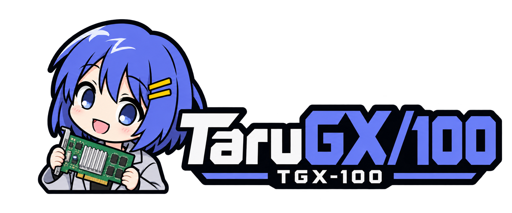

# TaruGX/100


Veryl HDLで開発している、PCI Express接続の実験用FPGA GPUです。

Linuxから外部DDR3のFramebufferへ描画し、HDMIへ出力します。





## 対象構成


| 項目 | 内容 |
| --- | --- |
| 製品名／型番 | TaruGX/100 / TGX-100 |
| ボード | Sipeed Tang Mega 138K **通常Dock版**（Pro版ではない） |
| FPGA | GW5AST-138BPG484AC2/I1、Rev.B |
| RTL | Veryl、ベンダーIP接続部はVerilog/SystemVerilog |
| FPGAツール | Gowin EDA |
| ホスト | Linux、独自DRM/KMSドライバー `tarugx` |
| 映像 | Flash版640×480、SRAM実験版1920×1080・約60Hz・RGB565 |
| メモリ | 外部DDR3、BAR2に4MiBのアクセス窓 |
| UEFI | X64 GOP、PCIe Option ROM |


PCIeはGen2 x1を設計目標としています。現在の検証構成にはx4設定のIPを使う
実験版があり、Gen2 x2でのリンクを確認しています。目標構成と実測値は区別しています。


## 実装済みの機能


- BAR0のレジスタアクセス、Byte Enable、Memory ReadへのCompletion応答
- HDMI単色表示と、DDR3からのFramebuffer Scanout
- Linux DRM/KMS、CPU描画のFramebuffer転送、Xfceデスクトップ表示
- ダブルバッファとVBlank同期ページフリップ、MSIによる完了待ち
- FPGA側の矩形fill／VRAM内blit、コマンドキューとfence
- ホストRAMからVRAMへのPCIe Memory Read DMA
- PCIe Option ROMからのGOP自動読込みとUEFI描画
- 検証したAMIホスト向けのPOST文字表示互換処理
- 起動時のロゴ表示と1秒の保持
- VerylによるUART診断、単体シミュレーションとソフトウェアテスト


一般的なGPUの代替として完成した製品ではなく、ボード・IP設定・ホストに依存する試作です。


## 構成


```text
Linux / UEFI
    │ PCI Express
Gowin Endpoint IP → TLP Bridge
    ├─ BAR0: GPUレジスタ
    ├─ BAR2: Framebuffer窓 → DDR3 → Scanout → HDMI
    └─ Expansion ROM: X64 GOPドライバー
```


| ディレクトリ | 内容 |
| --- | --- |
| `rtl/` | Veryl RTL |
| `tests/` | RTL・ソフトウェアのテスト |
| `fpga/` | ボード接続、制約、ベンダーIPラッパー |
| `drivers/tarugx/` | Linux DRM/KMSドライバー |
| `uefi/` | GOP、Option ROM、起動ロゴ |
| `host/` | ホスト側の表示設定と接続設定の雛形 |
| `scripts/` / `tools/` | 生成・ビルド・検証ツール |
| `vendor/` | IP設定入力。生成済みの専有IP本体は含めない |


## ビルドとテスト


### Veryl RTL


開発で使用したVerylは0.22.0です。シミュレーションにはVerilatorが必要です。


```sh
veryl fmt --check
veryl check
veryl build
veryl test --sim verilator
```


生成されたSystemVerilogは`build/`へ出力されます。Gowin固有IPを含む実機ビルドと、
モックを使った単体テストは別です。


### Linuxドライバー


実行するLinuxカーネルに対応したヘッダーを用意します。


```sh
make -C drivers/tarugx

# 別のカーネルビルドツリーを使う場合
make -C drivers/tarugx KDIR=/path/to/kernel/build
```


DRM/KMSドライバーです。VBlank通知にはMSIを1本使用し、INTxフォールバックとMSI-Xには未対応です。
全面更新はPCIe DMA（`dma_upload=0`でBAR2書込みへ切替）、部分更新はBAR2書込みで行います。
2D fill/blitは`drivers/tarugx/tarugx_drm.h`のprivate ioctlから利用でき、
VRAM GEMの直接scanout、PRIME dma-buf共有、binary／timeline syncobj、標準DRM schedulerによる
非同期実行に対応します。更新回数や転送量などのカウンタは、PCIデバイスのsysfs属性で確認できます。

ドライバーのロードやMMIO試験は対象PCIeデバイスを確認して行ってください。
描画中のデバイスへの生MMIO試験やFPGAの書換えは避け、先に描画とドライバーを停止します。

実機向けのビルド、テスト、インストールには`tools/`のスクリプトを使います。


```sh
python3 tools/build_remote_driver.py    # 実機カーネル向けビルド
python3 tools/test_drm_render_ioctl.py  # render ioctlの検証
python3 tools/test_drm_integration.py   # KMS／PRIME／scheduler等の一括検証
python3 tools/install_remote_driver.py  # 永続インストール
python3 tools/benchmark_drm_upload.py   # BAR2とDMAの全面更新比較
python3 tools/run_performance_demo.py   # 視覚デモ
```


### UEFI GOPとROM


X64向けのGCC/binutils、GNU-EFIのヘッダーとライブラリ、Python 3が必要です。
GNU-EFIが`/usr`以外にある場合は`EFI_ROOT`で指定します。


```sh
make -C uefi all test
make -C uefi "$PWD/build/uefi/TaruGxSplash.rom"
```


`TaruGxSplash.rom`は文字モード互換処理と1秒の起動ロゴを含む64KiB版です。
`TaruGxEarlyText.rom`はロゴなしの互換版、`TaruGxGop.rom`は通常版です。

通常版GOPはGPU versionを読み、旧FPGAでは640×480・XRGB8888、version 1.3以降では
1920×1080・RGB565を公開します。

画像データの再生成に限りImageMagickが必要です（`make -C uefi logo`）。


### FPGA実機ビルド


正常にライセンス認証できるGowin EDA環境と、通常Dock版の公式サンプル、
対象デバイス向けに生成したPCIe／DDR3／映像関連IPを別途用意してください。
このリポジトリだけで実機用ビットストリームを生成できる構成ではありません。

`GOWIN_ROOT`はEDAのインストール先に合わせてください。
公式サンプルの配置場所は次の環境変数で指定します。既定値は設けていません。


| 環境変数 | 指定する公式サンプルのディレクトリ |
| --- | --- |
| `SIPEED_PCIE_GEN2_DIR` | `examples/pcie_dma_demo/pcie_gen2(5G)` |
| `SIPEED_HDMI_DIR` | `examples/hdmi_colorbar/eda_proj/src` |
| `SIPEED_CAM_DIR` | `examples/cam_dvi/cam2dvi/src` |
| `SIPEED_DDR3_B_DIR` | `examples/cam_dvi/cam2dvi/src/ddr3_memory_interface` |


ビルドの入口は`scripts/gowin_build_framebuffer.tcl`です。


## 現在の制約


- Flash版と配布済みドライバーは640×480固定です。1920×1080・約60Hz（RGB565）はSRAM実験構成のみで、DDR調停はscanoutを3:1で優先します。
- 全面更新はPCIe DMA（最大8要求並列、scanout停止時に約700MB/s）、部分更新はBAR2書込みを使用します。
- 3Dアクセラレーションは未実装です。
- Legacy VGA I/O、VGA BIOS、他アーキテクチャ向けGOPは対象外です。
- GOPは`PixelBltOnly`で、Framebufferを通常のキャッシュ可能RAMとして公開しません。
- 長時間安定性・他ホストへの互換性は未検証です。
- PCI IDはサンプル由来の暫定値です。製品用の割当IDではありません。
- ベンダーIPや公式サンプルの利用条件は、それぞれの配布元の条件に従います。


## ライセンス


自作コード・設計の基本ライセンスはSolderpad Hardware License 2.1
（`Apache-2.0 WITH SHL-2.1`）です。LinuxドライバーはGPL-2.0-only、
ロゴは保有する権利の範囲でCC BY 4.0とします。

Gowin IPとその他の第三者由来部分には、それぞれの元の条件が適用されます。
適用範囲とライセンス本文は[LICENSE.md](LICENSE.md)を参照してください。


第三者由来部分の出典・変更内容・外部依存は[THIRD_PARTY_NOTICES.md](THIRD_PARTY_NOTICES.md)に記載しています。
